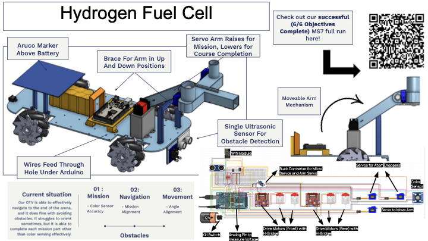

# Autonomous Survey Robot

An autonomous over-terrain vehicle (OTV) that navigates a 4m x 2m arena, completes a Hydrogen Fuel Cell mission, avoids obstacles, and reaches the end zone with no human input. Built on an Arduino MEGA in C++.

Built for ENES100 (Introduction to Engineering Design) at the University of Maryland, January to May 2026.

**Result: 6/6 objectives completed on the final Milestone 7 full run.**

## Highlights

- **Four-phase mission architecture:** a deterministic finite-state machine (navigate to mission site, complete mission, traverse obstacles, reach goal) instead of heuristic routing, so every run behaves predictably under time limits.
- **Closed-loop heading control:** PID correction driven by real-time position and heading from an overhead vision system tracking the ArUco marker mounted above the battery. This removes trajectory drift and keeps straight-line paths reliable across randomized obstacle layouts.
- **Color sensing and payload delivery:** a color sensor identifies the mission target, a servo-driven arm raises into position, and two micro-servo droppers release the "atom" payloads within 150mm of target.
- **Timer contention fix:** the Servo library and the drive motors' PWM competed for the same hardware timer, degrading motor response. Initializing the servos only during the mission phase kept the drive system fully responsive.

## Hardware

| Component | Role |
|---|---|
| Arduino MEGA 2560 | Main controller |
| 4x DC motors + mecanum wheels | Omnidirectional drive |
| 2x H-bridge motor drivers | Front and rear motor control |
| WiFi module + ArUco marker | Position and heading from overhead vision system |
| Ultrasonic sensor (front) | Obstacle detection |
| Color sensor | Mission target identification |
| Arm servo + 2x micro servos | Moveable arm and payload ("atom") droppers |
| Buck converter | Regulated power for all servos |
| 12V battery + kill switch | Main power and emergency stop |
| Analog voltage pin | Battery voltage monitoring |

## Mechanical Design

- **Moveable arm:** raises for the mission and lowers for course completion, so it stays clear of obstacles while driving.
- **Arm brace:** holds the arm firmly in both the up and down positions.
- **ArUco marker mount:** sits above the battery for an unobstructed view from the overhead camera.
- **Cable routing:** wires feed through a hole under the Arduino to keep the deck clean.

## How It Works

1. **Localize:** read position and heading from the vision system over WiFi.
2. **Navigate to mission site:** drive along a planned path with PID heading correction.
3. **Complete mission:** raise the arm, read the target color, and deploy the droppers.
4. **Traverse obstacles:** lower the arm, detect blocked lanes with the ultrasonic sensor, and reroute to an open one.
5. **Reach goal:** finish in the end zone.

## Running the Code

1. Install the [Arduino IDE](https://www.arduino.cc/en/software).
2. Open the main `.ino` file.
3. Install the required libraries via **Sketch > Include Library > Manage Libraries** (`Servo`, plus the ENES100 vision-system library).
4. Select **Board: Arduino Mega 2560** and the correct port, then upload.

## Demo

*[Link to the Milestone 7 full-run video]*

## Team

Natheer Muwonge ([GitHub](https://github.com/Natheer-Muwonge)) · *[teammate names]*

My contributions: *[e.g. navigation FSM, PID heading control, timer conflict debugging]*
